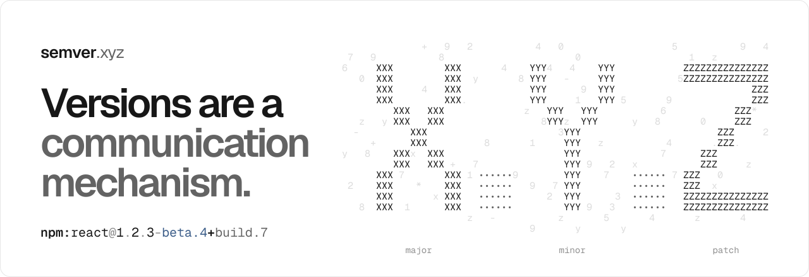

<picture>
  <source media="(prefers-color-scheme: dark)" srcset="assets/banner-dark.svg">
  
</picture>

<p align="center">
  <a href="https://semver.xyz/spec/"><b>Specification</b></a> ·
  <a href="https://semver.xyz/libraries/"><b>Libraries</b></a> ·
  <a href="https://semver.xyz/selector/"><b>Range selector</b></a> ·
  <a href="https://semver.xyz/faq/"><b>FAQ</b></a> ·
  <a href="https://semver.xyz/origin/"><b>History</b></a>
</p>

# Semantic Versions

An open specification for how version numbers are assigned, incremented,
grouped, compared and matched: a spiritual successor to
[Semantic Versioning 2.0.0-rc.1](https://semver.org/spec/v2.0.0-rc.1.html) that
restores build precedence and formally defines sets, ranges, comparators and
channels.

The specification lives in [`spec/SPEC.md`](spec/SPEC.md). This repository also
holds its extensions, the conformance suite, the reference implementation and
its ports, and the [semver.xyz](https://semver.xyz) site.

## Libraries

Every implementation passes the same [conformance suite](conformance) and is
[benchmarked](benchmarks) against the libraries it replaces.

<!-- languages:start -->
<!-- Generated by benchmarks/report.mjs from benchmarks/results/. Do not edit by hand. -->

| Language | Package | Conformance | Compared with | Speed vs. it |
| --- | --- | :---: | --- | ---: |
| [JavaScript](libraries/javascript) | `semantic-versions` (npm) | 476/476 | `semver` 396/476 | 1.3–6.7× |
| [Rust](libraries/rust) | `semantic-versions` (crates.io) | 476/476 | `nodejs-semver` 366/476 | 0.8–1.3× |
| [Python](libraries/python) | `semantic-versions` (PyPI) | 476/476 | `node-semver` 366/476 | 1.5–15× |
| [Go](libraries/go) | `semver.xyz/go` (pkg.go.dev) | 476/476 | `Masterminds/semver` 348/436 | 2.6–23× |
| [Ruby](libraries/ruby) | `semantic-versions` (RubyGems) | 476/476 | `semantic_range` 366/476 | 1.4–22× |
| [Java](libraries/java) | `xyz.semver:semantic-versions` (Maven Central) | 476/476 | `semver4j` 356/436 | 7.8–22× |
| [.NET](libraries/dotnet) | `SemanticVersions` (NuGet) | 476/476 | `Semver` 365/436 | 1.3–12× |
| [PHP](libraries/php) | `vltpkg/semantic-versions` (Packagist) | 476/476 | `composer/semver` 282/436 | 1.0–3.5× |

<!-- languages:end -->

## Where things live

Each document has exactly one source; the site renders or links to it rather
than keeping a second copy.

| What | Source of truth | On the site |
| --- | --- | --- |
| The specification | [`spec/SPEC.md`](spec/SPEC.md) | [`/spec/`](https://semver.xyz/spec/), rendered from the Markdown at build time |
| Extensions | [`extensions/*/*.md`](extensions) | [`/extensions/`](https://semver.xyz/extensions/), one presentation page each |
| FAQ | [`site/faq/index.html`](site/faq/index.html) | [`/faq/`](https://semver.xyz/faq/) |
| Comparison with SemVer 2.0.0 | [`site/proposal/index.html`](site/proposal/index.html) | [`/proposal/#compare`](https://semver.xyz/proposal/#compare) |
| BNF grammars | [`site/public/spec/*.bnf`](site/public/spec) | [`/grammar/`](https://semver.xyz/grammar/) |
| Conformance cases | [`conformance/*.json`](conformance) | run by every implementation's test suite |
| Implementations (for the page and READMEs) | [`benchmarks/languages.mjs`](benchmarks/languages.mjs) | [`/libraries/`](https://semver.xyz/libraries/) |
| Benchmark results | [`benchmarks/results/*.json`](benchmarks/results) | [`/libraries/`](https://semver.xyz/libraries/) and every package README, rendered from the JSON |

To change the specification, edit `spec/SPEC.md` and nothing else: it reads
correctly on GitHub, and `vlt run dev -w site` live-reloads `/spec/` as you
save. Keep headings plain where other pages link to them (`#context`,
`#precedence`, `#pre-release-channels`, `#build-channels`), since heading ids
follow GitHub's slug rules on both GitHub and the site.

## Layout

This repository is a [vlt](https://www.vlt.io) workspace (`vlt.json`):

```
.
├── spec/
│   └── SPEC.md               # The specification (canonical)
├── conformance/              # Language-neutral test cases (JSON) for any implementation
├── extensions/               # Extension specifications (markdown + source)
│   ├── variants/             # 1. Build Variants: which artifact
│   ├── integrity/            # 2. Package Integrity: which bytes
│   └── dependency-locks/     # 3. Dependency Locks: which graph (builds on 1 and 2)
├── libraries/                # One directory per language, all passing conformance/:
│   ├── javascript/           #   npm `semantic-versions` (the reference implementation)
│   ├── rust/                 #   crates.io `semantic-versions`
│   ├── python/               #   PyPI `semantic-versions`
│   ├── go/                   #   module `semver.xyz/go`
│   ├── ruby/                 #   RubyGems `semantic-versions`
│   ├── java/                 #   Maven Central `xyz.semver:semantic-versions`
│   ├── dotnet/               #   NuGet `SemanticVersions`
│   └── php/                  #   Packagist `vltpkg/semantic-versions`
├── benchmarks/               # Real-world corpus, results, and the shared table renderer
├── assets/                   # README banner (and the script that draws it)
└── site/                     # The semver.xyz static site (Vite, vanilla HTML/CSS/JS)
    ├── index.html            # Home
    ├── spec/                 # Template; content rendered from spec/SPEC.md
    ├── extensions/           # One page per extension, in layering order
    ├── grammar/              # BNF grammars + downloads
    ├── selector/             # Client-side range selector (uses the parser)
    ├── proposal/             # Semantic Versioning 3.0.0 proposal + 2.0.0 comparison
    ├── origin/               # History of build metadata
    ├── faq/                  # Frequently asked questions
    ├── libraries/            # Libraries in every language, benchmarks and conformance tables
    ├── license/
    ├── scripts/
    │   ├── render-spec.mjs   # Markdown → /spec/ (used by vite.config.js)
    │   └── ai-artifacts.mjs  # llms.txt, sitemap.xml, robots.txt, Markdown mirrors
    ├── public/               # favicon, fonts, downloadable *.bnf grammars
    └── src/                  # Shared design system (style.css) + shell (nav/footer)
```

## Develop

Install [vlt](https://www.vlt.io) (`curl -fsSL https://install.vlt.sh | bash`,
Node 22.22 or newer), then:

```sh
vlt install
vlt run dev -w site                    # start the site (Vite) at http://localhost:5173
vlt run build -w site                  # build the static site into site/dist
vlt run preview -w site                # preview the production build
vlt run test -w libraries/javascript   # run the parser test suite (tap), incl. conformance
vlt run bench -w libraries/javascript  # benchmark against node-semver, refresh the tables
```

The other implementations live outside the vlt workspace and use their own
toolchains; each README has the details:

```sh
cd libraries/rust && cargo test && cargo bench --bench compare
cd libraries/python && python -m unittest discover -s tests && python bench/compare.py
cd libraries/go && go test ./... && (cd bench && go run .)
cd libraries/ruby && bundle exec rake test && bundle exec rake bench
cd libraries/java && javac -d build $(find src -name '*.java') && java -cp build xyz.semver.ConformanceTest && bench/run.sh
cd libraries/dotnet && dotnet run --project tests/SemanticVersions.Conformance && dotnet run -c Release --project bench
cd libraries/php && composer install && composer test && composer bench
```

Each benchmark writes `benchmarks/results/<language>.json`. Afterwards,
`node benchmarks/report.mjs` refreshes the tables in every README; the site
renders the same results files at build time. To add a language, add it to
`benchmarks/languages.mjs`.

The root `package.json` also exposes convenience wrappers, e.g. `vlt run build`.

`dev` and `build` first run `site/scripts/ai-artifacts.mjs`, which writes the
machine-readable files served from the site root (`/llms.txt`, `/llms-full.txt`,
`/sitemap.xml`, `/robots.txt` and Markdown mirrors of the spec and extensions).
They are gitignored; never edit the copies under `site/public/`.

The [range selector](https://semver.xyz/selector/) imports the `semantic-versions`
parser directly, so the site and the reference implementation never drift.

## Deployment (Cloudflare Pages)

The site is a static [Cloudflare Pages](https://developers.cloudflare.com/pages/)
project, `semver-xyz`, served at [`semver.xyz`](https://semver.xyz). The custom
domain is attached to the Pages project in the Cloudflare dashboard;
[`wrangler.toml`](wrangler.toml) points Wrangler at `site/dist`.

```sh
vlt run deploy           # build, then publish site/dist to production (branch main)
vlt run deploy:preview   # build, then publish a preview deployment
vlt run cf:whoami        # check which Cloudflare account Wrangler is using
```

Use `wrangler pages deploy`, not `wrangler deploy`: the latter is the Workers
command and fails on a Pages project with "Missing entry-point to Worker script
or to assets directory".

[`.github/workflows/deploy.yml`](.github/workflows/deploy.yml) does the same on
every push to `main` once two repository secrets are set:

- `CLOUDFLARE_API_TOKEN`: an API token with the **Cloudflare Pages: Edit** permission
- `CLOUDFLARE_ACCOUNT_ID`: the account that owns the `semver-xyz` project

Without them the workflow still builds the site and skips the publish step.

Vite is configured with `base: "/"` because the site is served from the domain
root.

### Registry

[`vlt.json`](vlt.json) pins the npm registry alias to `https://registry.npmjs.org/`
under its `config` key, so `vlt-lock.json` resolves from the public registry for
everyone (CI included) rather than from whatever registry a contributor's
user-level vlt config points at.

## License

The specification and extension texts are licensed under
[CC BY 3.0](https://creativecommons.org/licenses/by/3.0/). The code (every library
under `libraries/`, the benchmarks and the site) is licensed under the
[Apache License 2.0](LICENSE).

Releasing a library: see [`.github/RELEASING.md`](.github/RELEASING.md).
